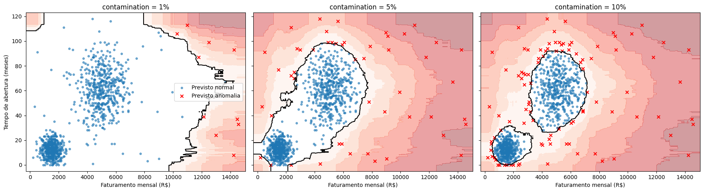
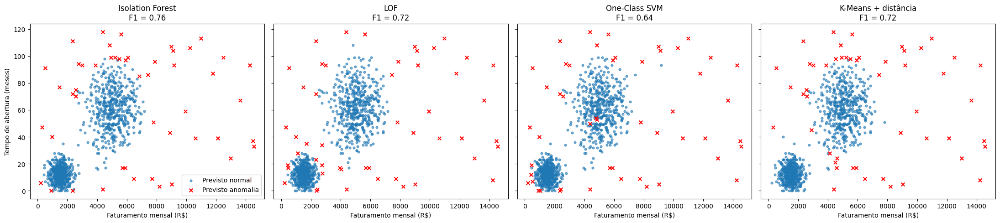

# Detecção de Anomalias com Isolation Forest

[](https://colab.research.google.com/github/michellesilvaah/deteccao-anomalias-isolation-forest/blob/main/notebooks/isolation_forest_analise.ipynb)


Investigação teórica e experimental do algoritmo não supervisionado **Isolation Forest** (Liu, Ting & Zhou, 2008) aplicado à detecção de anomalias em dados tabulares desbalanceados.

## Contexto e Motivação
Em cenários reais — como prevenção a fraudes, manutenção preditiva e monitoramento de qualidade cadastral — eventos anômalos são raros e geralmente não possuem rótulos históricos. Diferente de abordagens baseadas em distância ou densidade, o Isolation Forest isola observações por meio de partições aleatórias: pontos anômalos exigem caminhos mais curtos nas árvores de isolamento.

## Estrutura dos Experimentos
1. **Fundamentação Matemática:** Funcionamento das *iTrees*, normalização pelo comprimento médio esperado $c(n)$ e interpretação do *anomaly score* $s(x, n)$.
2. **Dataset Sintético (Cadastro de MEI):** Base fictícia em 2D (`faturamento_mensal` × `tempo_abertura_meses`) com 1.000 registros (95% normais em dois perfis operacionais e 5% de anomalias distribuídas uniformemente, incluindo casos camuflados nos clusters normais).
3. **Sensibilidade de Hiperparâmetros:** Análise do impacto de `contamination` (1%, 5% e 10%), `n_estimators` e `max_samples` sobre as fronteiras de decisão e métricas de classificação.
4. **Benchmark entre Detectores:** Comparação de desempenho frente a **K-Means**, **Local Outlier Factor (LOF)** e **One-Class SVM**.
5. **Validação em Base Real:** Aplicação e análise crítica no dataset **Breast Cancer Wisconsin** em cenário de alta dimensionalidade.

## Principais Resultados

### 1. Efeito do parâmetro `contamination`
Alterar `contamination` desloca apenas o limiar de corte sem modificar a ordenação dos scores (`ROC-AUC` e `PR-AUC` permanecem invariantes):

| `contamination` | Accuracy | Precision | Recall | F1-Score | ROC-AUC | PR-AUC |
| :---: | :---: | :---: | :---: | :---: | :---: | :---: |
| **0.01** | 0.960 | 1.000 | 0.200 | 0.333 | 0.946 | 0.810 |
| **0.05** | 0.976 | 0.760 | 0.760 | 0.760 | 0.946 | 0.810 |
| **0.10** | 0.934 | 0.420 | 0.840 | 0.560 | 0.946 | 0.810 |



### 2. Benchmark entre Algoritmos


## Como Reproduzir Localmente

```bash
git clone [https://github.com/michellesilvaah/deteccao-anomalias-isolation-forest.git](https://github.com/michellesilvaah/deteccao-anomalias-isolation-forest.git)
cd deteccao-anomalias-isolation-forest
pip install -r requirements.txt
jupyter notebook notebooks/isolation_forest_analise.ipynb

---
*Projeto desenvolvido por **[Michelle de Sales Silva](https://www.linkedin.com/in/michelle-silva-8413b92b7/)** no âmbito da disciplina de Aprendizado de Máquina I (Fatec Jundiaí).*
